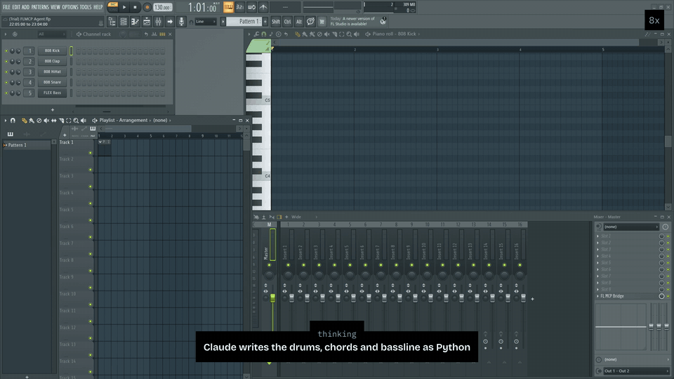

# FL Studio Agent

<p align="center">
  
</p>

`fl-studio-agent` lets an AI agent work in your own FL Studio.
It writes notes, sets tempo, levels and plugin parameters, checks which channels sound, and renders the mix.
It is an MCP server, a Python SDK, and a native Bridge plugin.

<!-- install:start (generated by scripts/install_links.py; edit there) -->
[](https://cursor.com/en/install-mcp?name=fl-studio&config=eyJjb21tYW5kIjoidXZ4IiwiYXJncyI6WyItLXB5dGhvbiIsIjMuMTIiLCJmbC1zdHVkaW8tYWdlbnQiXX0%3D)
[](https://insiders.vscode.dev/redirect/mcp/install?name=fl-studio&config=%7B%22type%22%3A%22stdio%22%2C%22command%22%3A%22uvx%22%2C%22args%22%3A%5B%22--python%22%2C%223.12%22%2C%22fl-studio-agent%22%5D%7D)
[](https://github.com/origami-research/fl-studio-agent/releases/latest/download/fl-studio-agent.mcpb)
[](https://pypi.org/project/fl-studio-agent/)
[](https://github.com/origami-research/fl-studio-agent/blob/main/LICENSE)

**Claude Code:**

```bash
claude mcp add --scope user fl-studio -- uvx --python 3.12 fl-studio-agent
```

## Quick start

You need FL Studio 2026 on macOS or Windows and [uv](https://docs.astral.sh/uv/getting-started/installation/).

1. **Install uv** if you don't have it.
   macOS: `curl -LsSf https://astral.sh/uv/install.sh | sh`.
   Windows: `powershell -ExecutionPolicy ByPass -c "irm https://astral.sh/uv/install.ps1 | iex"`, then open a new terminal so `uvx` is on your PATH.
   Also on Windows, install [loopMIDI](https://www.tobias-erichsen.de/software/loopmidi.html), add two ports named exactly `FLMCP Req` and `FLMCP Res`, and tick **Autostart loopMIDI** in its tray menu so the ports come back after a restart (Windows has no virtual MIDI ports; macOS needs nothing).
2. **Set up FL Studio once.** Start FL once if you never have, close it, then run (on Windows, in a terminal opened as administrator, because FL's plugin folder is under Program Files):

   ```bash
   uvx --python 3.12 --from fl-studio-agent fl-mcp-install
   ```

   It installs the controller and note scripts, assigns the controller's MIDI ports, creates the agent's own project (`FLMCP Agent.flp`; your other projects are never touched), and downloads the prebuilt [Bridge plugin](https://github.com/origami-research/fl-studio-agent/blob/main/SETUP.md#the-bridge-plugin), the native FL effect the server requires to write notes and render, checking it against the release's SHA-256 sums.
   It is safe to rerun.
   To update later, run it with `fl-studio-agent@latest` in place of `fl-studio-agent` and restart FL and your client.
3. **Open the agent project in FL Studio**: File > Open, `FLMCP Agent.flp` in FL's Projects folder (`Documents/Image-Line/FL Studio/Projects`).
   It carries the Bridge on its Master insert; in any other song there is no Bridge running, so notes and `render` are refused.
4. **Add the server to your client** with a button above or a config below, and ask for "a 4-bar chord loop in A minor".

<details>
<summary><b>Claude Code</b></summary>

```bash
claude mcp add --scope user fl-studio -- uvx --python 3.12 fl-studio-agent
```

Check it with `claude mcp list`.
</details>

<details>
<summary><b>Claude Desktop</b></summary>

Download [fl-studio-agent.mcpb](https://github.com/origami-research/fl-studio-agent/releases/latest/download/fl-studio-agent.mcpb) and open it (or drag it into Settings > Extensions).
Claude Desktop installs the package itself; you still run step 2 once, which also installs the Bridge plugin the server requires into FL.

Or add this to `claude_desktop_config.json` (Settings > Developer > Edit Config):

```json
{
  "mcpServers": {
    "fl-studio": {
      "command": "uvx",
      "args": [
        "--python",
        "3.12",
        "fl-studio-agent"
      ]
    }
  }
}
```

If Claude Desktop reports `spawn uvx ENOENT`, it cannot see your shell's PATH: replace `"uvx"` with the full path that `which uvx` (macOS) or `where uvx` (Windows) prints.
</details>

<details>
<summary><b>Cursor</b></summary>

Use the **Install in Cursor** button above, or add this to `~/.cursor/mcp.json`:

```json
{
  "mcpServers": {
    "fl-studio": {
      "command": "uvx",
      "args": [
        "--python",
        "3.12",
        "fl-studio-agent"
      ]
    }
  }
}
```
</details>

<details>
<summary><b>VS Code</b></summary>

Use the **Install in VS Code** button above, or run (macOS/Linux shell quoting):

```bash
code --add-mcp '{"name": "fl-studio", "type": "stdio", "command": "uvx", "args": ["--python", "3.12", "fl-studio-agent"]}'
```
</details>

<details>
<summary><b>Windsurf and other clients</b></summary>

Add the standard entry to the client's MCP config (Windsurf: `mcp_config.json`, see [its MCP docs](https://docs.windsurf.com/windsurf/cascade/mcp)):

```json
{
  "mcpServers": {
    "fl-studio": {
      "command": "uvx",
      "args": [
        "--python",
        "3.12",
        "fl-studio-agent"
      ]
    }
  }
}
```
</details>

## Troubleshooting

Run the doctor while FL Studio is open:

```bash
uvx --python 3.12 --from fl-studio-agent fl-mcp-doctor
```

It prints one JSON report of the control plane (controller script and MIDI ports), the note plane (the Bridge), and the agent project.
Its `status` is `ok` only when all of them are connected, and `not_ready` otherwise, with a `fix` for each one that is not.
The usual fixes: open `FLMCP Agent.flp` in FL Studio before your client starts the server (the doctor reports no running Bridge when another song is open, and rerunning step 2 when none is installed); after an upgrade rerun step 2 with `fl-studio-agent@latest` (a stale controller is reported); on Windows, keep loopMIDI running with both ports.
Using the FL Studio trial? Set `FLMCP_FL_LICENSE=trial` in the server's `env`, and answer **No** when FL asks to save `FLMCP Agent.flp`: the trial cannot reopen a song it saved. If it was saved, delete it and rerun step 2, which creates it again.
`uvx --python 3.12 fl-studio-agent --version` prints the installed version.
<!-- install:end -->

## Tools

The server exposes five tools, one per job:

| Tool | Purpose |
| --- | --- |
| `run` | Execute Python against the FL SDK: write and clear notes, tempo, levels, parameters. Its docstring is the SDK cheatsheet. |
| `get_scene` | Read what FL has now: a compact musical summary, or the notes (`detail="notes"`, by channel and pattern). |
| `check` | Play a few bars and read FL's mixer meters: which channels sounded, their peaks, and why a silent one is silent. |
| `render` | Play the live arrangement once and record the mix to WAV. |
| `analyze` | Analyze a WAV deterministically. |

The working rhythm is write, check at milestones, render at the end.
Every result is what FL now has, so nothing needs waiting for, saving, or re-reading.
FL's transient refusals ("operation unsafe at current time", a busy control wire) are retried inside the engine; a model sees only errors it can act on.
Setup diagnostics are for the operator, not the model: `fl-mcp-doctor` prints the same report as JSON.

## How it works

Three complementary lanes: [`flpkit`](https://pypi.org/project/flpkit/) edits project files, the native Bridge plugin performs live host operations, and the MIDI controller script handles live controller operations.
[SETUP.md](SETUP.md) covers installing from a source checkout and building the Bridge.

## Security

The Python the model writes in `run`, and the shell and file tools when they are on, runs in a sandbox limited to its own workspace folder, on macOS and Windows.
It can read and write that folder and reach the public internet, so `pip install` works.
It cannot read your home folder or your other files, reach services on this computer (FL's control ports included), or touch other programs.
The engine itself, FL Studio and the Bridge are not sandboxed; the model's code reaches FL only through the engine.
Before any model code runs, the engine checks that the sandbox holds and refuses to run the code if it does not; the MCP server reports `confined=true`.
On macOS the sandbox does not block other computers on your local network.
Details: [docs/38](docs/38-python-kernel.md).

## Development

For a disposable live smoke session, run `fl-mcp-dev-session`. For the local merge gate, run:

```bash
scripts/gate.sh
```

The gate is the authoritative test count and verification contract; see [docs/gate.md](docs/gate.md) for its current stages.

## Documentation

- [SETUP.md](SETUP.md): installation from source, the Bridge plugin, Windows.
- [docs/README.md](docs/README.md): current documentation map.
- [docs/24-coverage-map.md](docs/24-coverage-map.md): capability status.
- [RUNBOOK_E2E.md](RUNBOOK_E2E.md): end-to-end verification.
